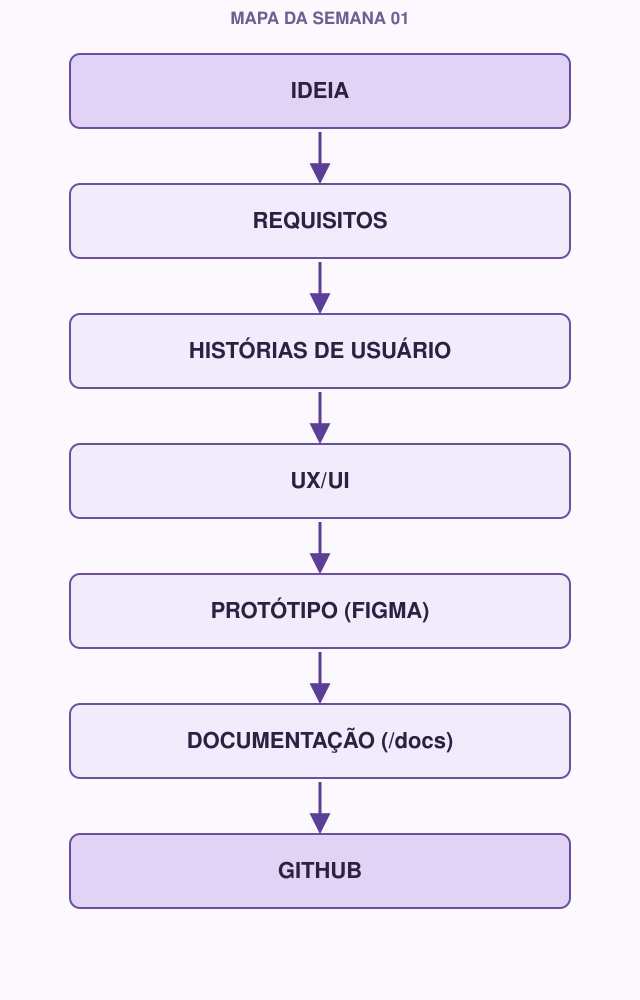

# 00 | Start here

[Português](../docs/00-comece-aqui.md) · English

Welcome to Week 01 of **Coffee & Code**

This document is your starting point. Read it in full before opening any other module; it explains what you are going to build, why the week's topics come in the order they do, and what you will need to deliver at the end.

---

## What you are going to build

Throughout this week, you will take the first steps of a software project **before writing any code**. That includes:

- Defining **the problem** the project solves and **who** will use it.
- Writing that down as **requirements** and **user stories**.
- Thinking about the **user flow** (UX) and drawing the first screens (UI).
- Creating a **clickable prototype in Figma**.
- Documenting all of it inside the project repository, in a `/docs` folder.
- Organizing that repository on **GitHub**, using **Git** to version your work.

By the end of the week, you will not have a single line of working code, and that is fine. You will have something more important for a good start: **clarity about what to build and why**.

## Why this order

A common mistake when starting out is opening the code editor on day one and just typing away. The problem is that, without first answering "who am I building this for?" and "what does this person need to do?", it is very easy to build the wrong thing, or to build the right thing in a confusing way.

Every real software project follows this path (more or less explicitly):

```
problem → requirements → user → interface → documentation → project organization → code
```

This week exists so you can walk this path once, from the beginning, on a small project, so that when it is time to code (week 02 onward), you already know what you are building and why.

## Map of the week



Each arrow on this map is one of this week's modules. No module stands alone; each one feeds the next.

## Order of the modules

You will notice that the order of the files is not exactly the same as the order on the map above. That is on purpose.

| Order | Module | Why in this position |
|---|---|---|
| 01 | Git | Before producing any content, you need to know how to keep its history |
| 02 | GitHub | Where that history will live and be shared |
| 03 | Markdown | The "language" you will use to document everything on GitHub |
| 04 | Requirements | The real starting point of the project: the problem and what needs to be solved |
| 05 | UX/UI | How to think about how the system is used before drawing any screen |
| 06 | Figma | The tool to turn that thinking into a prototype |
| 07 | Design System | Visual consistency across the screens you just created |
| 08 | Initial architecture | How all of this starts to become a view of the system (stronger for experienced members) |

In other words: first you build the "shelf" (Git, GitHub, Markdown) where the work will be kept, then you produce the content (Requirements, UX/UI, Figma, Design System, Architecture) and put each piece on the shelf as you go.

## Tools you will use

- **Git**: installed on your machine ([git-scm.com](https://git-scm.com))
- **GitHub**: free account ([github.com](https://github.com))
- **Figma**: free account ([figma.com](https://figma.com)), can be used right in the browser
- Any text editor to write Markdown (VS Code is a good choice, but not required)

You do not need to install anything besides Git. GitHub and Figma work in the browser.

## Two tracks, one project

Throughout the modules you will see two kinds of sections:

- **If you are just starting**: more detailed explanations, no rush, without assuming you have seen it before.
- **If you already have experience**: deeper dives, extra good practices and challenges for people who already know the basics.

That does not mean two different courses. Everyone works **on the same project**. The only difference is the depth of each part. If you are experienced, the beginner sections are still worth reading: many experienced people skip fundamentals and miss them later.

## What you will deliver at the end

1. **A `/docs` folder** inside the project repository, with at least:
   - `requisitos.md` (requirements)
   - `historias-de-usuario.md` (user stories)
   - `design-system.md`
   - (`arquitetura.md`, the architecture document, is expected mainly from experienced members, but everyone can start theirs)
2. **An initial prototype in Figma**, clickable, representing the main screens defined in the requirements.

It does not need to be perfect. It needs to exist and make sense with what you defined during the week.

> The file names stay in Portuguese so they match the rest of the track and the examples in the following weeks.

## How to study

Coffee & Code is 100% online, and each module was written to be self-contained: you can study at your own pace, without depending on being on a call. The weekly meetings, also online, are there to answer questions and show what you have built, not to "give a class".

Suggested pace (adjust to the time you have):

- [ ] Days 1-2: Modules 01, 02 and 03 (Git, GitHub, Markdown)
- [ ] Day 3: Module 04 (Requirements)
- [ ] Day 4: Modules 05 and 06 (UX/UI and Figma)
- [ ] Day 5: Module 07 (Design System)
- [ ] Day 6: Module 08 (Architecture, mainly for experienced members) and general review
- [ ] Day 7: Finish the deliverable and, if available, take the CHECKPOINT

When you finish the modules, see `challenges.md` (to go further) and `deliverable.md` (final checklist before submitting).

---

**Next module:** `01-git.md`
