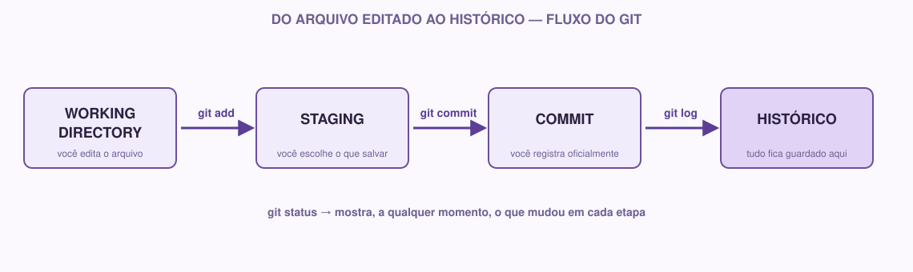

# 01 | Git

[Português](../docs/01-git.md) · English

> Previous module: `00-start-here.md` · Next module: `02-github.md`

## What it is

Imagine you are writing a paper and saving several versions of it: `paper.docx`, `paper_final.docx`, `paper_final_v2.docx`, `paper_final_for_real.docx`. In practice, that is a (pretty bad) form of manual version control.

**Git is a program that does this in an organized way.** It keeps the history of every change made to a project, so you can:

- See exactly what changed, when and by whom.
- Go back to a previous version if something breaks.
- Work with other people on the same project without overwriting each other's work.

This is called **version control**. Git is the most widely used version control system in the world today.

## Why we use it

In any project that lasts more than a day or involves more than one person, some questions come up naturally:

- "This function worked yesterday, what did I change that broke it?"
- "My classmate and I edited the same file at the same time, now what?"
- "I accidentally deleted an important chunk, can I get it back?"

Without version control, the answer is usually "no" or "only with a lot of stress". With Git, these questions have answers:

- You compare versions with `git log` and `git diff`.
- Git helps **combine** changes from different people (merge).
- The whole history is saved: nothing is truly lost.

**If you are just starting:** do not worry about understanding everything at once. In this module you will only use Git locally, on your own, on your computer. Putting the project online comes calmly in the GitHub module.

## A real example

Imagine you are building the Coffee & Code website. On day 1, you create the home page. On day 3, you decide to change the background color, but after changing it, you realize the old version looked better.

Without Git: you would have to remember exactly what the old color code was (or hope you saved a copy somewhere).

With Git: you run a command, go back to the version before the change, and carry on with the project. The whole history is stored, step by step.

## Concepts you need before the commands

Before typing commands, it is worth understanding four words that show up all the time in Git:

### Repository (repo)

It is your project folder, but with a "superpower": Git is watching everything that happens inside it and keeping the history of changes. A repository can live only on your computer (**local repository**) or also on a server, such as GitHub (**remote repository**; that is the subject of the next module).

### Working directory

It is simply your project's files, the way they are right now, in the folder, on your computer. If you open a file and edit a line, that change is happening in the working directory: Git has already noticed that something changed, but it has not officially "saved" that change in the history yet.

### Staging (staging area)

Think of it as an "outbox". Before officially recording a change in the history, you choose which files (or which changes) you want to include in that record. Putting a file in staging is telling Git: "I want this to be part of the next record in the history".

Why does this exist? Because you do not always want to save *all* changes at once. Maybe you edited three files, but only two of them are ready to become a record. Staging lets you choose.

### Commit

It is the record itself. A commit is a "snapshot" of the project at that moment, with a message explaining what changed. It is the basic unit of Git's history.

Putting it all together:



## How to do it

### Installing Git

If you do not have Git installed yet:

- **Windows:** download it from [git-scm.com](https://git-scm.com) and install it normally (you can keep the default options).
- **Mac:** open Terminal and type `git --version`. If it is not installed, the system itself will offer to install it.
- **Linux:** `sudo apt install git` (Ubuntu/Debian) or your distribution's equivalent.

To confirm it worked, open the terminal and type:

```bash
git --version
```

It should show something like `git version 2.43.0`. If a version number shows up, you are all set.

### `git init` | creating a repository

Go to your project folder in the terminal and type:

```bash
git init
```

This turns the current folder into a Git repository. What happens behind the scenes: Git creates a hidden folder called `.git` inside your project, where it will keep the whole history. You do not need to touch it directly.

### `git status` | what is happening right now

```bash
git status
```

This command is your best friend. It shows:

- Which files were modified.
- Which files are in staging (ready to become a commit).
- Which files are not being tracked by Git yet.

Use `git status` whenever you are unsure about what is going on. There is no "wrong" way to use this command; it only looks and reports, it does not change anything.

### `git add` | putting it in staging

```bash
git add file-name.md
```

This puts the given file in staging (the "outbox" we saw above).

To put **all** modified files in at once:

```bash
git add .
```

The `.` means "the current folder and everything inside it".

### `git commit` | recording the change

```bash
git commit -m "Create initial project structure"
```

The `-m` is followed by the **commit message**: a short sentence explaining what this change does. Good commit messages describe the action, not the feeling: `"Fix error in total calculation"` is better than `"tweaks"` or `"works now"`.

### `git log` | viewing the history

```bash
git log
```

It shows the list of commits made, from the most recent to the oldest, with author, date and message. For a more compact version:

```bash
git log --oneline
```

## Git ≠ GitHub

This mix-up is extremely common, so it is worth making it very clear:

- **Git** is the program that runs on your computer and controls the version history. It works even without internet.
- **GitHub** is a website that hosts Git repositories in the cloud, letting you share your code, collaborate with other people and keep a remote backup of your project.

In other words: Git is the tool, and GitHub is a place (one of several; there are alternatives such as GitLab and Bitbucket) where you can store and share what Git is tracking.

## If you are just starting

There is nothing wrong with getting a command wrong or being confused by `git status` at first; that is normal for everyone. A tip: whenever you try something new, run `git status` before and after the command, to see exactly what changed. That builds intuition fast.

## If you already have experience

A few points to pay attention to right away, even if the deeper side comes later:

- Think of commit messages as part of the project's documentation: a good commit history tells the story of how the project was built.
- Start getting used to small, frequent commits instead of one giant commit at the end of the day. That makes it easier to go back if something breaks.
- It is worth setting your name and e-mail globally now:
  ```bash
  git config --global user.name "Your Name"
  git config --global user.email "you@email.com"
  ```

## Practice on your own

1. Create a folder called `git-practice` on your computer.
2. Run `git init` inside it.
3. Create a file `notes.md` with any sentence inside.
4. Run `git status` and look at what shows up.
5. Run `git add notes.md` and then `git status` again; notice the difference.
6. Make your first commit: `git commit -m "First test commit"`.
7. Edit the `notes.md` file, adding one more line.
8. Run `git status` again. What changed?
9. Add and commit that change.
10. Run `git log --oneline` and see the two commits you just created.

> Keep `cheatsheet-git-github.md` (or the image in `docs/assets/cheatsheet-git-github.svg`) as a quick reference; you do not need to memorize the commands.

**Module checklist:**

- [ ] Git installed and `git --version` working
- [ ] I understand the difference between working directory, staging and commit
- [ ] I made at least two commits in a practice folder
- [ ] I understand the difference between Git and GitHub

---

**Next module:** `02-github.md`: let's take this local repository to the cloud.
