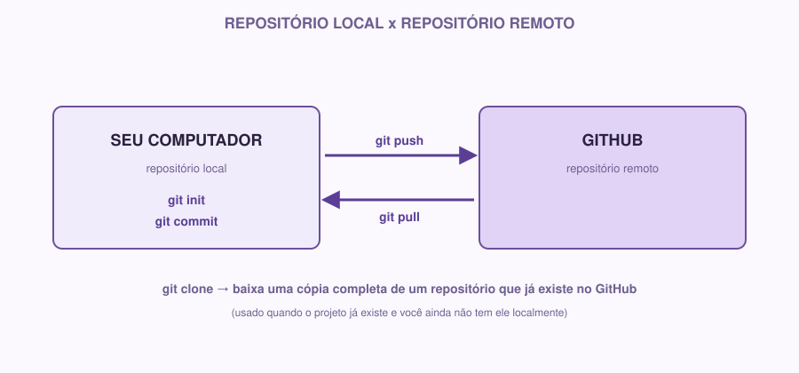

# 02 | GitHub

[Português](../docs/02-github.md) · English

> Previous module: `01-git.md` · Next module: `03-markdown.md`

## What it is

In the previous module, you created a **local** Git repository; it exists only on your computer. If your hard drive fails tomorrow, that history goes with it.

**GitHub is a website that hosts Git repositories in the cloud.** It lets you:

- Keep a copy of your project stored outside your computer.
- Share that project with other people.
- Work as a team on the same repository, without passing files around on WhatsApp or a USB stick.
- Track tasks, bugs and ideas through **Issues**.

## Why we use it

Picture a team of 4 people working on the same project. Without a central place:

- How does each person know which version of the code is the latest?
- How do you combine everyone's work without overwriting what someone else did?
- Where do the history of decisions, bugs found and pending tasks live?

GitHub solves this by being the project's "meeting point": everyone sends (`push`) their changes there and fetches (`pull`) other people's changes from there.

## A real example

You and two other people are building the Coffee & Code app. Each one works on a different part: one person works on the login screen, another on the profile screen, and another writes the documentation. Without GitHub, you would have to keep sending files to each other and hope nothing gets overwritten. With GitHub, each person works on their part, sends (`push`) their changes, and the central repository brings everyone's work together.

## Main concepts

### Remote repository

It is the version of your repository hosted on GitHub, instead of only on your computer. You can have a local and a remote repository connected: changes in one can be sent to or brought from the other.



### Clone

**Cloning** is downloading a full copy of a repository that already exists on GitHub to your computer, including the whole commit history.

```bash
git clone https://github.com/user/repository-name.git
```

Use it when the project **already exists** on GitHub and you want to work on it locally (for example, when joining a project that is already under way).

### Push

**Push** is sending your local commits to the remote repository on GitHub.

```bash
git push
```

Think of it this way: you made commits on your computer (local history). `push` syncs that history with GitHub, so other people (and you, from another computer) can see those changes.

### Pull

**Pull** is the opposite direction: bringing the changes that are on GitHub (made by you or by other people) to your computer.

```bash
git pull
```

Rule of thumb: always `pull` before you start working, to make sure you are starting from the latest version of the project.

### Branches (introduction)

A **branch** is a parallel line of development. By default, every repository has a main branch (usually called `main`). When you want to try something new without risking breaking what already works, you create a separate branch, work on it, and only later combine (`merge`) those changes back into `main`.

```bash
git branch branch-name     # creates a new branch
git checkout branch-name   # switches to that branch
# or, in a single command:
git checkout -b branch-name
```

**If you are just starting:** this week you do not need to master branches, just understand that they exist and what they are for. We will go deeper in future weeks.

### README

`README.md` is the first file anyone sees when opening your repository on GitHub. It should quickly answer: what this project is, how to run it, and where to find more information. It is the repository's "business card".

### Issues

**Issues** are like the project's list of tasks and problems, inside GitHub itself. Each issue is one specific item: a bug to fix, a feature to build, a question to answer. Issues can be assigned to people, have labels and be closed when resolved.

Example issue:

```
Title: Login button does not work on mobile
Description: When tapping "Sign in" on small screens, nothing happens.
Expected: Tapping should open the login form.
```

## How to do it

### 1. Creating an account

Create a free account at [github.com](https://github.com), if you do not have one yet.

### 2. Creating a repository on GitHub

On GitHub, click **New repository**. Give it a name, choose whether it will be public or private, and check the option to create an initial `README.md`.

### 3. Connecting your local repository to a remote repository

If you already have a local repository (from module 01) and want to connect it to a repository you just created on GitHub:

```bash
git remote add origin https://github.com/your-user/repo-name.git
git push -u origin main
```

`origin` is just a nickname for the remote repository's address; it is the default name used by the community.

### 4. Basic project organization

A simple structure to start with:

```
project-name/
├── README.md
├── docs/
│   ├── requisitos.md
│   ├── historias-de-usuario.md
│   ├── arquitetura.md
│   └── design-system.md
└── (the rest of the code comes in the next weeks)
```

## If you are just starting

If the command line still feels intimidating, know that GitHub also has a visual interface (GitHub Desktop) that does `add`, `commit`, `push` and `pull` with buttons, without typing commands. It is fine to use it at first, but it is worth understanding what each button does behind the scenes, because the commands show up practically everywhere people talk about development.

## If you already have experience

For experienced members, it is worth going deeper on four points that make a difference in real projects:

**Naming conventions.** Consistent branch names (`feature/login`, `fix/signup-bug`), commit messages following a standard (for example, [Conventional Commits](https://www.conventionalcommits.org/): `feat: add login screen`, `fix: correct email validation`).

**A folder structure planned from the start**, even if there is no code yet; this makes life easier for whoever joins the project later:

```
project/
├── docs/
├── src/          # source code (coming in the next weeks)
├── tests/        # tests (coming too)
├── .gitignore
└── README.md
```

**Pull Requests (PR).** Instead of pushing straight to the main branch, the professional flow is: create a branch, make the changes, and open a **Pull Request** asking for those changes to be reviewed and merged into `main`. This allows code review before anything enters the main project. We will practice this actively from Week 02 on, but it is already worth building the habit of thinking in branches + PR instead of committing straight to `main`.

**Project organization.** Decide right away: how you will use issues to track what is left to do, and where technical decisions are recorded (a good answer: inside `/docs` itself, in a decisions file).

## Practice on your own

1. Create a GitHub account (if you do not have one yet).
2. Create a new repository called `coffee-code-sem01` (it can be public).
3. Clone that repository to your computer.
4. Inside it, create the `docs/` folder (empty for now, or with a `.gitkeep` file).
5. Commit that change and `push` it to GitHub.
6. Check on the GitHub website that the `docs/` folder shows up there.
7. Create an Issue in your repository describing the first task of the week, for example: "Define the project requirements".

If you are experienced, also do this: create a branch called `docs/initial-structure`, make the changes above inside it, and then open a Pull Request from your branch to `main` (you do not need to merge it yet, just practice creating the PR).

> See also `cheatsheet-git-github.md` for a quick reference of all of this week's Git and GitHub commands, side by side.

**Module checklist:**

- [ ] GitHub account created
- [ ] `coffee-code-sem01` repository created and cloned locally
- [ ] `docs/` folder created, committed and pushed to GitHub
- [ ] At least one Issue created
- [ ] Experienced members: branch and Pull Request created

---

**Next module:** `03-markdown.md`: let's learn how to actually write this documentation.
