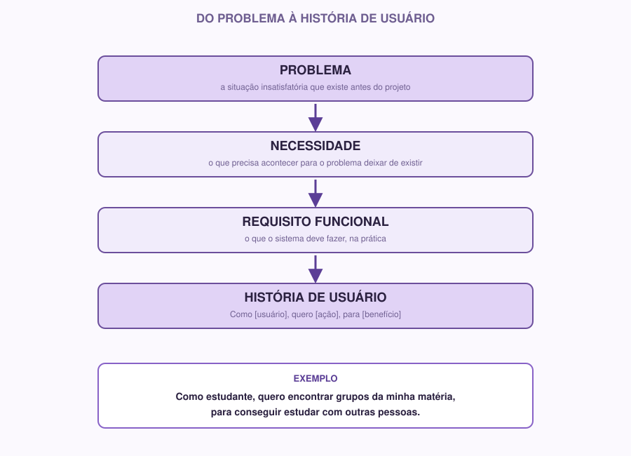

# 04 | Requirements Engineering

[Português](../docs/04-requisitos.md) · English

> Previous module: `03-markdown.md` · Next module: `05-ux-ui.md`

## Start with the problem

Imagine the following situation:

> A company wants to build a system. Before coding, how do we know what needs to be done?

It sounds obvious, but this is the question most software projects get wrong in practice. It is extremely common for a team to spend weeks coding something that, in the end, does not solve anyone's problem, because nobody stopped to clearly define what the problem was before diving into code.

**Requirements Engineering** is exactly the stage of discovering and writing down, clearly, what a system needs to do, before starting to build it.

## Why we use it

Without clear requirements:

- Each person on the team understands "the project" in a different way.
- It is easy to build features nobody asked for, while what really matters is left out.
- It is hard to know when the project is "done". Done for what, exactly?

With well-defined requirements, you have a reference document: whenever a question comes up about "should this be part of the project?", the answer is there.

## The concepts, one at a time

### Problem

It is the unsatisfactory situation that exists **before** the project: the pain that motivated the idea. A problem is not a disguised solution. "Students don't have an app" is not a problem; it is already a solution (the app). The underlying problem could be: "students have a hard time finding study groups".

### Need

It is what has to happen for the problem to stop existing. From the problem above: "students need an easy way to find other people studying the same subject".

### Stakeholder

It is any person or group that has an interest in, or is affected by, the project. Not every stakeholder is a direct user of the system. Examples in a study group app:

- **Direct users:** students who will use the app.
- **Other stakeholders:** the course coordination (may want usage reports), teaching assistants (may be responsible for approving groups).

### Requirement

It is a condition or capability the system needs to have. Requirements are split into two types:

### Functional requirement

Describes **what the system does**: an action, a feature.

Examples:
- The system must allow the user to create an account.
- The system must allow groups to be created by subject.
- The system must send a notification when someone joins the group.

### Non-functional requirement

Describes **how** the system should behave: qualities, constraints, general characteristics that are not a specific action.

Examples:
- The system must load the list of groups in under 2 seconds.
- The system must work correctly on phones with small screens.
- User passwords must be stored encrypted.
- The system must be available in Portuguese.

A simple way to remember the difference: a functional requirement is **what**, a non-functional requirement is **how well** or **under which conditions**.

### User story

It is a way of writing a functional requirement **from the perspective of whoever will use the system**, instead of writing it as a cold technical instruction. The standard format is:

```
As a [type of user], I want [goal], so that [benefit].
```

For example, instead of writing:

> "The system must allow searching groups by subject."

You write:

> "As a student, I want to search groups by the subject I am taking, so that I can quickly find people studying the same content as me."

The difference may look small, but it matters: the user story forces you to think about **who** needs it and **why**, not just **what**. That helps you keep the original problem in sight as the project moves forward.



## A real example, from start to finish

**Problem:** Students have a hard time finding study groups.

**Main user:** University students.

**Functional requirements:**
- The system must allow groups to be created by subject.
- The system must allow students to find existing groups.
- The system must allow users to join a group.

**Non-functional requirement:**
- The system must be usable on phones, since most students will access it from their smartphone between classes.

**User stories:**
- As a student, I want to find groups for my subject, so that I can study with other people.
- As a student, I want to create a new group when none exists yet, so that I can bring together classmates interested in the same topic.

Notice that each user story is directly tied to one of the functional requirements above; they are not made up out of nowhere, they are the same information seen from an angle closer to whoever will use the system.

## How to do it

1. **Write the problem in one sentence.** If you cannot sum it up in one sentence, it is probably not clear enough yet.
2. **Identify the main user**: if there is more than one type of user, identify all of them, but choose one as the main focus for this week.
3. **List 3 to 6 functional requirements.** Start with the most essential: what the system *needs* to do to solve the problem, without which it makes no sense.
4. **Identify 1 to 3 non-functional requirements** relevant to your project (performance, security, accessibility, compatibility, etc.).
5. **Turn the main functional requirements into user stories**, using the format `As a [user], I want [action], so that [benefit]`.
6. **Write all of this in `docs/requisitos.md` and `docs/historias-de-usuario.md`.**

Suggested structure for `docs/requisitos.md`:

```markdown
# Project Requirements

## Problem

[one clear sentence]

## Target audience

[who the main user is]

## Functional Requirements

- The system must...
- The system must...

## Non-Functional Requirements

- The system must...
```

And for `docs/historias-de-usuario.md`:

```markdown
# User Stories

As a [user], I want [action], so that [benefit].

As a [user], I want [action], so that [benefit].
```

> You can write the content of these files in English or Portuguese; just keep the file names (`requisitos.md`, `historias-de-usuario.md`) so they match the rest of the track.

## If you are just starting

On a first attempt, it is normal to write requirements that are too vague ("the system must be good") or too specific ("the button must be blue #1E90FF"; that is a design decision, not a requirement). A good test: read your requirement and ask "can we tell whether this was met or not?". If the answer is clear, the requirement is well written.

## If you already have experience

Some points to explore further:

- **Prioritization.** Not every requirement carries the same weight. Mark which ones are essential for a first version (MVP) and which are "nice to have, but not urgent". A simple technique is the **MoSCoW** method: Must have, Should have, Could have, Won't have (for now).
- **Traceability.** Each requirement should be traceable to a user story and, later on, to a prototype screen and to a task/issue on GitHub. That avoids "orphan requirements" nobody knows the origin of.
- **Ambiguity is the enemy.** Reread your requirements as if you were someone else reading them for the first time: is there any sentence that could be read in two different ways?

## Activity

Choose a central feature of your project (or, if you do not have a defined project yet, choose a simple idea, for example a system to organize Coffee & Code's own meetings) and:

1. Write the problem it solves, in one sentence.
2. Write 3 to 5 functional requirements related to that feature.
3. Write at least 1 relevant non-functional requirement.
4. Turn the main functional requirements into 2 to 3 user stories, in the format `As a [user], I want [action], so that [benefit]`.
5. Save everything in `docs/requisitos.md` and `docs/historias-de-usuario.md`, then commit and push.

These user stories will be the exact basis for the prototype you will create in the Figma module; they are not an isolated exercise.

**Module checklist:**

- [ ] Project problem written in one sentence
- [ ] Main user identified
- [ ] Functional requirements listed
- [ ] At least 1 non-functional requirement listed
- [ ] User stories written in the standard format
- [ ] `docs/requisitos.md` and `docs/historias-de-usuario.md` filled in, committed and pushed

---

**Next module:** `05-ux-ui.md`: let's think about how the user will actually use this.
