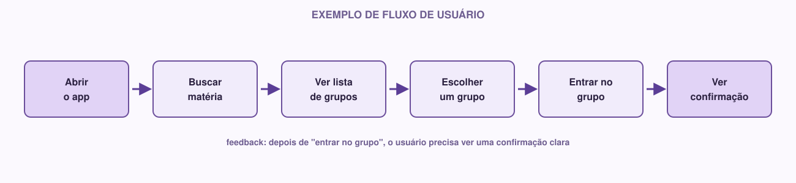

# 05 | UX/UI

[Português](../docs/05-ux-ui.md) · English

> Previous module: `04-requirements.md` · Next module: `06-figma.md`

This module is not a full design course; it is enough for you to make better decisions in the prototype you will create in the next module.

## What it is

**UX** (User Experience) is about **what it is like** to use the system: is it easy to understand what to do? Can the person complete the task without getting confused? Do they know whether an action worked?

**UI** (User Interface) is what the person actually sees and touches: the buttons, colors, text, icons and screen layout.

## The difference between the two

A simple way to understand the difference: UX is the **reasoning**, UI is the **visual result** of that reasoning.

Example: a food delivery app.

- **UX** decides: after the user places the order, they need to know the order was received, how long it will take, and have a way to track its status. That is the experience that makes sense.
- **UI** decides: how that shows up on the screen: a progress bar, colors used to indicate "being prepared" vs "on the way", the font size of the text "Order confirmed!".

It is possible to have a beautiful UI with bad UX (a gorgeous screen that is confusing, where the user does not know what to click), and the opposite too: a very well-thought-out flow with a visually poor interface. The goal is to have both working together.

## Main concepts

### User flow

It is the path a person takes inside the system to complete a task. For example, the flow of "joining a study group":

```
Open the app → search subject → see list of groups → choose a group → join the group → get confirmation
```

Thinking about the flow **before** drawing any screen avoids a common mistake: creating isolated screens that look nice but do not connect in a logical way.

### Wireframe

It is a simple sketch of a screen, with no visual style. Just the structure: where the title goes, where the button goes, where the list goes. Think of a black-and-white draft, usually made quickly, on paper or in a simple tool, before any concern with color or typography.

The goal of the wireframe is to validate the **structure** (what is on each screen and where) before spending time on aesthetics.

### Prototype

It is a clickable (or nearly clickable) version of the product, usually already looking closer to the final product, where you can click on elements and "move" between screens as if the system already existed, even though there is no real working code behind it. That is what you will build in Figma in the next module.

### Visual consistency

It means elements with the same function look the same on every screen. If the main button is blue and rounded on the login screen, it should stay blue and rounded on the sign-up screen, not suddenly turn green and square. Inconsistency confuses the user, because they lose the visual cues they learned to recognize.

### Feedback

It is the response the system gives the user after an action. Every important action needs some kind of feedback:

- Clicked "Send"? Something needs to confirm it was sent (or that there was an error).
- Filled in a field incorrectly? The system needs to point out which field and why.

Without feedback, the user does not know whether something worked, and tends to click again (sometimes causing problems, such as submitting a form twice).

### Visual hierarchy

It is the way the elements of a screen show, through size, color, position and contrast, what matters most. A heading should look stronger than secondary text; the main action button should stand out more than a secondary action button ("Cancel", for example). When everything on the screen has the same visual weight, the user does not know where to look first.

## A real example

Back to the study group app, with the requirement: *"As a student, I want to find groups for my subject, so that I can study with other people."*

**Flow:**



**UX/UI decisions derived from this flow:**
- Search needs to be visible as soon as the app opens (not hidden in a menu).
- The list of groups needs to show enough information to decide without clicking each one (subject name, number of participants).
- After clicking "Join", the user needs to see a clear confirmation; otherwise they do not know if it worked.

Notice that none of these decisions depended on choosing colors or fonts yet; that is UX. The specific colors and fonts come later, and are part of UI (and of the Design System, module 07).

## How to do it

Before opening Figma, do this reasoning on paper (or in a text file):

1. **Choose your project's main flow**: usually tied to the most important user story you wrote in the previous module.
2. **List the screens needed** for that flow, in order.
3. **For each screen, write down:** what the user sees, what they can do there, and where they go next.
4. **Think about feedback:** at which points in the flow does the system need to confirm something to the user?

This turns straight into the structure of your prototype in Figma.

## If you are just starting

Do not worry about making a "perfect" or complete flow. Take only the most important path in your system: usually 3 to 5 screens are enough to represent a central feature well. A small, well-thought-out flow is better than a huge, confusing one.

## If you already have experience

Some points to explore further:

- **Also map the "alternative paths":** what happens if the search finds no groups? What happens if the user tries to join a group that is already full? These states (empty, error, loading) are often forgotten, but they are a real part of the experience.
- **Think about affordance:** a clickable element should "look" clickable (shadow, color, border); even before any interaction, its appearance already communicates what can be done.
- **Consider accessibility right away:** enough contrast between text and background, adequate touch target size for elements on mobile screens, alternative text on images.

## Activity

1. Take the main user story you wrote in module 04.
2. Write the full flow for that story, from start to finish, listing each screen involved.
3. For each screen, write 2-3 lines describing: what appears, what the user can do, what happens next.
4. Identify at least one point in the flow where the system needs to give the user feedback.

Keep these notes: they will be the direct basis of the Figma prototype in the next module.

**Module checklist:**

- [ ] I understand the difference between UX and UI
- [ ] Main project flow mapped, screen by screen
- [ ] Feedback points identified
- [ ] Experienced members: alternative paths (empty, error) considered

---

**Next module:** `06-figma.md`: time to turn this flow into real screens.
