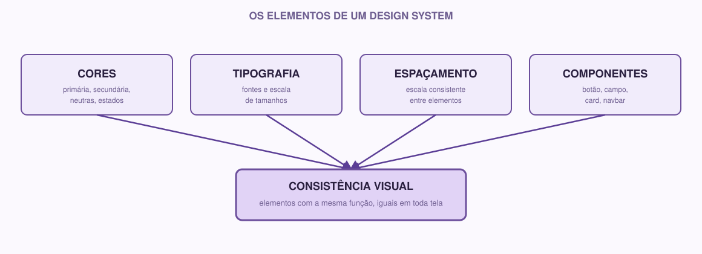

# 07 | Design System

[Português](../docs/07-design-system.md) · English

> Previous module: `06-figma.md` · Next module: `08-architecture.md`

## What it is

After creating a few screens in Figma, you have probably noticed something: maybe a button ended up blue on one screen and green on another, or the spacing between elements varies for no clear reason from one screen to the next. This happens naturally when each screen is drawn without a shared reference.

A **Design System** is exactly that set of visual decisions and rules (colors, typography, spacing, components) documented in one place, so that every screen in the project (and everyone working on it) follows the same standard.

## Why we use it

Without a design system:
- Each new screen risks "inventing" its own style.
- It is hard to keep the same standard as the project grows or when someone else needs to continue the work.
- Small inconsistencies (a slightly different button here, another one there) pile up and make the product look less professional and more confusing to use.

With a design system, these decisions are made once, documented and reused, saving time and ensuring consistency.

## The elements of a design system



### Colors

Define a small palette with a clear purpose; it is not about having many colors, it is about knowing exactly when to use each one. A simple, functional palette usually has:

- **Primary color**: the product's main accent color (used on primary action buttons, links, highlighted elements).
- **Secondary color** (optional): supports the primary color.
- **Neutrals**: shades of gray for text, backgrounds, borders.
- **State colors**: green for success, red for error/alert, yellow for warning.

Example:

```
Primary:   #2563EB (blue)
Secondary: #F59E0B (orange)
Neutrals:  #FFFFFF, #F3F4F6, #6B7280, #111827
Success:   #16A34A
Error:     #DC2626
```

### Typography

Define which font(s) the project uses, and a size scale for the different levels of text:

```
Heading (H1):    28px, bold
Subheading (H2): 20px, bold
Body text:       16px, regular
Small text:      13px, regular
```

You do not need more than one or two different fonts in the whole project.

### Spacing

Defining a spacing scale keeps each screen from using random amounts of space between elements (8px here, 13px there, 21px somewhere else). A common scale, based on multiples of 4 or 8:

```
4px, 8px, 16px, 24px, 32px, 48px
```

Whenever you space elements, pick a value from this scale instead of a random number.

### Buttons

Define what the primary button looks like (background color, text color, rounded or square corners, text size), and keep that look on every screen where the button has the same function. It is also worth visually distinguishing a primary action button from a secondary one (for example, "Confirm" vs "Cancel").

### Fields (inputs)

Like buttons, form fields (text boxes, selects, etc.) should look consistent: border, inner spacing, how they look when focused (the user clicked on them) and how they look when there is a validation error.

### Components

They are the reusable pieces built from the decisions above: the button, the text field, the card, the navigation bar (navbar). In Figma, this connects directly to the components you learned to create in the previous module.

### States

The same component can look different depending on the situation: a button can be normal, "hover" (when the mouse is over it), pressed, or disabled. A text field can be empty, filled, focused, or showing an error. Thinking about these states now avoids incomplete screens as the project grows.

### Consistency

In the end, all this work serves a single principle: **elements with the same function should look the same anywhere in the product**. That is the ultimate goal of a design system; it is not about having rules for the sake of rules, it is about creating a coherent experience for whoever uses the system.

## A real example

Back to the study group app, part of a design system could be:

```markdown
## Colors
- Primary: #2563EB, used on the "Join" button and on links
- Dark neutral: #111827, used on headings
- Light neutral: #F3F4F6, used on card backgrounds

## Initial components
- Navbar
- Group card (subject name + number of participants + "Join" button)
- Primary button
- Search field
```

## How to do it

1. **Look at the screens you already created in Figma** and notice: which colors did you use? Is there any inconsistency between screens?
2. **Choose a small palette** (3-6 colors) with a clear purpose for each one.
3. **Define the typography**: at the very least, the sizes for headings and normal text.
4. **Define the spacing** you will use as the default.
5. **List the components that repeat** across your screens (button, card, search field, navbar, etc.).
6. **Document all of this** in `docs/design-system.md`.
7. **Go back to Figma and adjust** the screens to follow these decisions, if they do not already.

Suggested structure for `docs/design-system.md`:

```markdown
# Design System

## Colors

- Primary: #______
- Secondary: #______
- Neutrals: #______, #______
- Success: #______
- Error: #______

## Typography

- Heading:
- Subheading:
- Body text:

## Spacing

- Scale used:

## Components

- [ ] Primary button
- [ ] Secondary button
- [ ] Text field
- [ ] Card
- [ ] Navbar

## States considered

-
```

## If you are just starting

Start small. Three colors, one font and a simple spacing scale are already enough to make this week's prototype consistent. You can (and should) expand this design system in the coming weeks, as the project grows.

## If you already have experience

It is worth going deeper on:

- **Design tokens.** Instead of scattering color and spacing values directly in components, think of them as named variables (`color-primary`, `spacing-md`); this makes it easier, later on, to change a value in a single place and have it reflected across the whole system (including in code, further ahead).
- **Color accessibility.** Check the contrast between text and background (there are free WCAG contrast checker tools). A nice color without enough contrast hurts readability for many users.
- **Living documentation.** Treat `design-system.md` as a document that will evolve; every time a new visual decision is made in the project, it should be reflected there, not only in Figma.
- In Figma, use **Styles** (color styles and text styles) so the design system decisions are actually linked to the elements, not just documented separately.

## Activity

1. Define your color palette, typography and spacing scale.
2. List the components that repeat in your prototype.
3. Fill in `docs/design-system.md` with these decisions.
4. Go back to the Figma screens and adjust at least one element to follow these decisions more consistently (for example, making sure all primary action buttons have the same color).
5. Commit and push the updated file.

**Module checklist:**

- [ ] Color palette defined with a clear purpose for each color
- [ ] Typography defined (at least heading and body text)
- [ ] Spacing scale defined
- [ ] Main components listed
- [ ] `docs/design-system.md` filled in, committed and pushed
- [ ] Experienced members: states and color contrast considered

---

**Next module:** `08-architecture.md`: how to start thinking about the system behind these screens.
