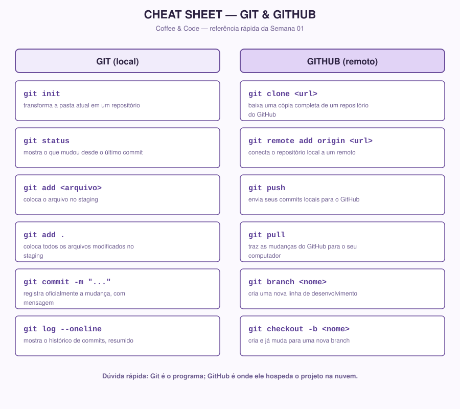

# Cheat Sheet | Git & GitHub

[Português](../docs/cheatsheet-git-github.md) · English

> Quick reference for the Git and GitHub commands used in Week 01. It is not new content; it is just a visual summary of what was already explained in `01-git.md` and `02-github.md`. Keep this tab open while you practice.

## Text version (to copy and paste)

### Git (local)

| Command | What it does |
|---|---|
| `git init` | Turns the current folder into a repository |
| `git status` | Shows what changed since the last commit |
| `git add <file>` | Puts the file in staging |
| `git add .` | Puts all modified files in staging |
| `git commit -m "..."` | Officially records the change, with a message |
| `git log --oneline` | Shows the commit history, summarized |

### GitHub (remote)

| Command | What it does |
|---|---|
| `git clone <url>` | Downloads a full copy of a repository from GitHub |
| `git remote add origin <url>` | Connects the local repository to a remote one |
| `git push` | Sends your local commits to GitHub |
| `git pull` | Brings the changes from GitHub to your computer |
| `git branch <name>` | Creates a new line of development |
| `git checkout -b <name>` | Creates a new branch and switches to it |

**Quick reminder:** Git is the program; GitHub is where it hosts the project in the cloud.
